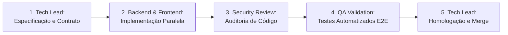

# Governança do Ecossistema Multi-Agent: Laboratório de Autenticação

Este documento estabelece as diretrizes de cooperação, papéis, responsabilidades e fluxos de trabalho para o time multi-agente responsável pelo desenvolvimento do projeto.

---

## 1. Princípios Fundamentais

1. **Fonte Única da Verdade (Single Source of Truth)**:
   Os documentos contidos no diretório `docs/` (`requirements.md`, `architecture.md`, `api-contract.md` e `decisions.md`) são a referência canônica do projeto. Qualquer alteração estrutural ou de contrato deve ser refletida nesses documentos com aval do **Tech Lead Agent** antes de ser codificada.

2. **Trabalho Colaborativo e Revisão Cruzada (Peer Review)**:
   Nenhum agente opera em isolamento completo. A implementação de uma camada deve ser compreendida e validada pelas camadas adjacentes:
   - O **Frontend Agent** valida se os endpoints do **Backend Agent** atendem com precisão à experiência do usuário e aos contratos de tipos.
   - O **Security Agent** audita tanto o código de Backend quanto o de Frontend contra vetores de ataque conhecidos (OWASP Top 10).
   - O **QA Agent** atua como validador independente de todos os critérios de aceite antes da conclusão de qualquer fase.

3. **Código Limpo, Tipado e Testável**:
   - Todo código TypeScript deve possuir tipagem estrita (`strict: true`), sem uso de `any` injustificado.
   - Todo código Python deve seguir as convenções PEP 8, com type hints completos e validação Pydantic v2.
   - Nenhuma funcionalidade é entregue sem testes automatizados correspondentes.

---

## 2. Catálogo de Agentes e Especialidades

### 👑 Tech Lead Agent
- **Responsabilidade Principal**: Liderança técnica geral, definição arquitetural, design de contratos da API, arbitragem de decisões técnicas e homologação de entregas.
- **Entregáveis**: `docs/`, planejamento de sprints/fases, resolução de bloqueios e garantia de consistência sistêmica.

### 🐍 Backend Agent
- **Responsabilidade Principal**: Desenvolvimento da API FastAPI, persistência relacional com PostgreSQL, modelos SQLAlchemy 2.0 assíncronos, migrações Alembic e serviços de autenticação.
- **Entregáveis**:
  - Configuração do FastAPI e injeção de dependências (`get_db`, `get_current_user`).
  - Hashing com Argon2id e geração/validação de JWT.
  - Rotação de Refresh Tokens e verificação de Google ID Token (`google-auth`).
  - Testes automatizados com Pytest (`tests/`).

### ⚛️ Frontend Agent
- **Responsabilidade Principal**: Desenvolvimento da interface moderna em React + TypeScript + Vite, gerenciamento de estado global de autenticação e comunicação HTTP resiliente.
- **Entregáveis**:
  - Telas de Cadastro, Login (local e Google Sign-In) e Dashboard protegido.
  - `AuthContext` e hook customizado `useAuth`.
  - Instância do Axios com interceptor de renovação silenciosa com fila (concurrency lock).
  - Testes de componentes e integração de UI com Vitest.

### 🛡️ Security Agent
- **Responsabilidade Principal**: Threat modeling, garantia de conformidade com OWASP ASVS, auditoria de segurança de endpoints, mitigação de XSS/CSRF e testes de invasão simulados.
- **Entregáveis**:
  - Auditoria de cookies (`HttpOnly`, `SameSite`, `Path`).
  - Verificação de políticas de CORS e Rate Limiting.
  - Validação de testes de detecção de reuso de token (Token Reuse Attack).
  - Checklist de segurança pré-produção.

### 🧪 QA / Test Agent
- **Responsabilidade Principal**: Garantia da qualidade de ponta a ponta, validação dos critérios de aceite de cada requisito funcional e testes de cenários de borda.
- **Entregáveis**:
  - Matriz de testes de regressão e aceitação.
  - Testes de integração entre Frontend e Backend.
  - Validação de fluxos de concorrência, expiração de tokens e reconexão.

---

## 3. Fluxo de Trabalho Integrado e Ciclo de Vida da Tarefa

1. **Definição**: O Tech Lead formaliza o escopo e o contrato em `docs/`.
2. **Construção Paralela**:
   - Backend implementa a API baseada estritamente em `docs/api-contract.md`.
   - Frontend implementa a interface consumindo mocks ou o contrato tipado em TypeScript.
3. **Revisão de Segurança**: O Security Agent inspeciona o código backend (validação de tokens, cookies, hashing) e frontend (injeção, sanitização).
4. **Validação de QA**: O QA Agent executa a suíte de testes ponta a ponta e cenários de estresse.
5. **Aprovação**: O Tech Lead valida a entrega final e consolida a fase.