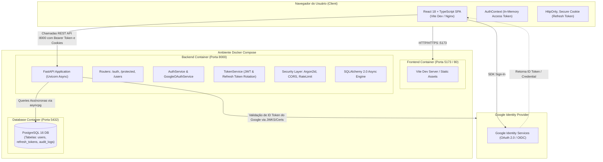
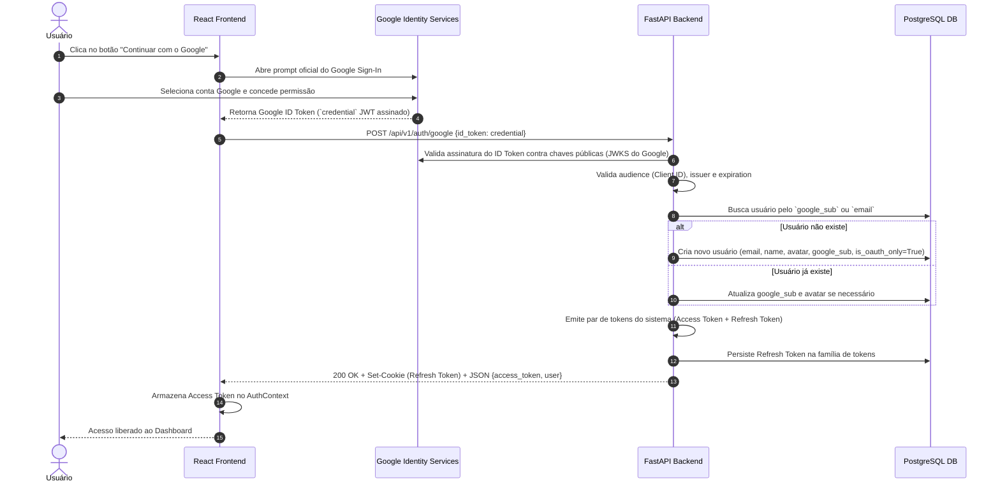
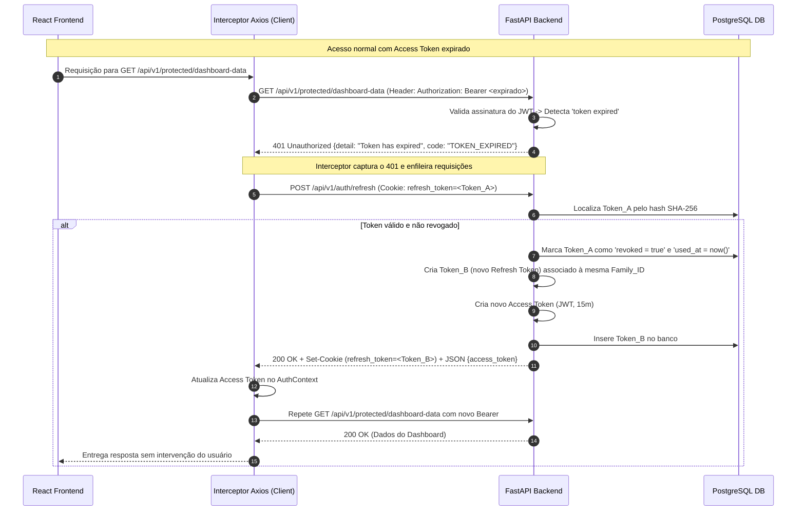
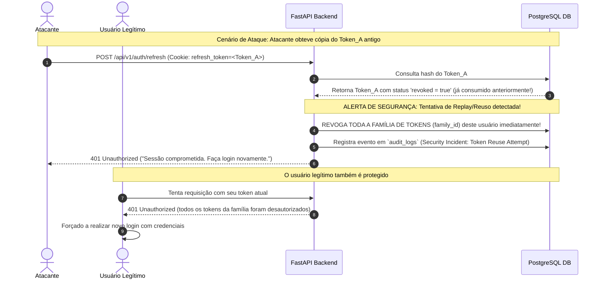
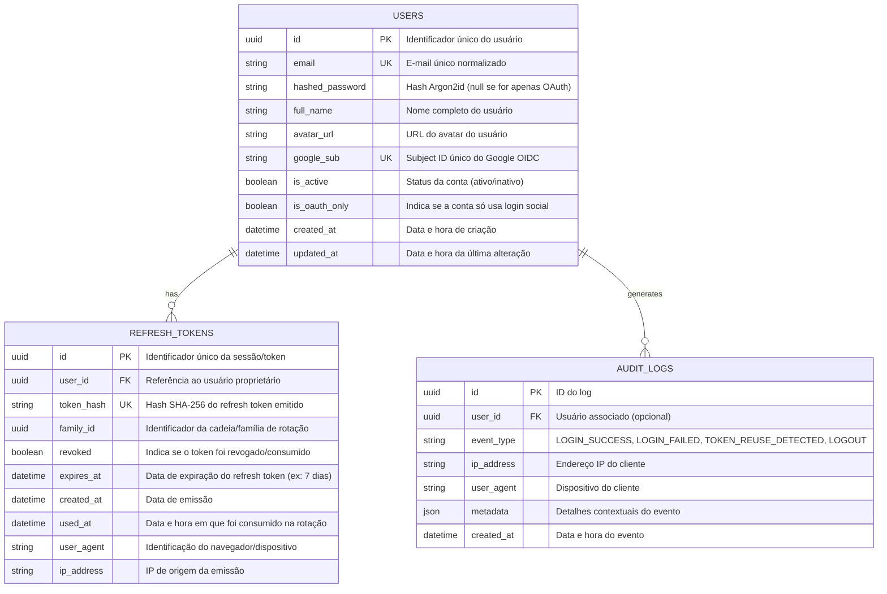

# Arquitetura do Sistema: Laboratório de Autenticação Multi-Agent

## 1. Visão Geral da Arquitetura

O sistema adota uma arquitetura em camadas orientada a serviços desacoplados (Frontend Single-Page Application + Backend RESTful API + Banco de Dados Relacional), orquestrada em contêineres Docker independentes.

### Stack Tecnológica
- **Frontend**: React 18+ com TypeScript, empacotado via Vite, estilizado com CSS moderno/Tailwind tokens, consumindo a API via Axios com interceptores configurados para controle de sessão.
- **Backend**: Python 3.12+ com FastAPI, utilizando SQLAlchemy 2.0 (modo assíncrono com `asyncpg`), migrações automáticas de banco via Alembic, e validação/serialização estrita com Pydantic v2.
- **Banco de Dados**: PostgreSQL 16 para persistência transacional ACID de usuários, credenciais e sessões de refresh tokens rotativos.
- **Orquestração e Infraestrutura**: Docker e Docker Compose, provendo isolamento de rede, injeção segura de variáveis de ambiente e inicialização facilitada para desenvolvimento e testes.

---

## 2. Diagrama de Contêineres e Topologia



---

## 3. Diagramas de Sequência e Fluxos de Autenticação

### 3.1. Fluxo de Cadastro e Login com E-mail e Senha

```mermaid
sequenceDiagram
    autonumber
    actor User as Usuário
    participant React as React Frontend (SPA)
    participant API as FastAPI Backend
    participant DB as PostgreSQL DB

    %% Cadastro
    Note over User, DB: Fluxo de Cadastro (Sign-up)
    User->>React: Preenche Nome, E-mail, Senha
    React->>API: POST /api/v1/auth/register (payload JSON)
    API->>API: Valida formato de e-mail e força da senha
    API->>DB: Verifica existência de e-mail
    alt E-mail já cadastrado
        DB-->>API: Usuário encontrado
        API-->>React: 409 Conflict ("E-mail já registrado")
        React-->>User: Exibe mensagem de erro amigável
    else E-mail livre
        API->>API: Gera Hash da senha com Argon2id
        API->>DB: Salva novo registro na tabela `users`
        DB-->>API: Usuário criado (id, email, created_at)
        API-->>React: 201 Created (UserResponse sem dados sensíveis)
        React-->>User: Redireciona para tela de login ou autentica
    end

    %% Login
    Note over User, DB: Fluxo de Login (Sign-in)
    User->>React: Informa E-mail e Senha
    React->>API: POST /api/v1/auth/login {email, password}
    API->>DB: Busca usuário ativo pelo e-mail
    alt Usuário não encontrado ou senha inválida
        API->>API: Executa dummy hash verification (mitigar timing attack)
        API-->>React: 401 Unauthorized ("Credenciais inválidas")
        React-->>User: Exibe erro genérico
    else Credenciais válidas
        API->>API: Gera Access Token (JWT, exp: 15m)
        API->>API: Gera Refresh Token aleatório (64 bytes) e Family ID
        API->>DB: Salva hash SHA-256 do Refresh Token com exp: 7d
        API-->>React: 200 OK + Set-Cookie (Refresh Token; HttpOnly; SameSite=Lax; Secure) + JSON {access_token, token_type, expires_in, user}
        React->>React: Salva Access Token em memória (AuthContext)
        React-->>User: Redireciona para o Dashboard protegido
    end
```

---

### 3.2. Fluxo de Autenticação Federada com Google (OIDC / OAuth 2.0)



---

### 3.3. Rotação de Refresh Token e Silent Refresh



---

### 3.4. Detecção de Roubo de Token (Reuso de Refresh Token)



---

### 3.5. Fluxo de Logout Seguro

```mermaid
sequenceDiagram
    autonumber
    actor User as Usuário
    participant React as React Frontend
    participant API as FastAPI Backend
    participant DB as PostgreSQL DB

    User->>React: Clica em "Sair" (Logout)
    React->>API: POST /api/v1/auth/logout (Cookie: refresh_token)
    API->>DB: Marca o Refresh Token como 'revoked = true'
    API-->>React: 200 OK + Set-Cookie (refresh_token=""; Max-Age=0; Expires=Thu, 01 Jan 1970 00:00:00 GMT)
    React->>React: Limpa Access Token em memória (AuthContext = null)
    React-->>User: Redireciona para /login
```

---

## 4. Modelo de Dados (DER)



---

## 5. Estrutura de Diretórios Recomendada

```
agents-test-auth/
├── .agents/                    # Definições de Agentes e Skills Antigravity
│   ├── agents/
│   │   ├── backend/agent.md
│   │   ├── frontend/agent.md
│   │   ├── lead/agent.md
│   │   └── security/agent.md
│   └── skills/
│       ├── backend-engineering/SKILL.MD
│       ├── frontend-design/SKILL.md
│       └── security-review/SKILL.md
├── docs/                       # Especificações e Fonte da Verdade do Sistema
│   ├── requirements.md
│   ├── architecture.md
│   ├── api-contract.md
│   └── decisions.md
├── backend/                    # Aplicação FastAPI
│   ├── app/
│   │   ├── api/
│   │   │   └── v1/
│   │   │       ├── endpoints/
│   │   │       │   ├── auth.py
│   │   │       │   └── protected.py
│   │   │       └── router.py
│   │   ├── core/
│   │   │   ├── config.py       # Configurações com Pydantic Settings
│   │   │   ├── database.py     # Engine assíncrono SQLAlchemy e sessionmaker
│   │   │   ├── security.py     # Argon2id, JWT creation, claims
│   │   │   └── exceptions.py   # Handlers de exceção RFC 7807
│   │   ├── models/             # Modelos SQLAlchemy ORM
│   │   │   ├── user.py
│   │   │   ├── token.py
│   │   │   └── audit.py
│   │   ├── schemas/            # Schemas Pydantic v2 (DTOs)
│   │   │   ├── user.py
│   │   │   ├── token.py
│   │   │   └── auth.py
│   │   ├── services/           # Lógica de negócio pura
│   │   │   ├── auth_service.py
│   │   │   ├── token_service.py
│   │   │   └── google_oauth.py
│   │   └── main.py             # Instância do FastAPI, CORS, middlewares
│   ├── alembic/                # Migrações de banco
│   │   ├── env.py
│   │   └── versions/
│   ├── tests/                  # Suíte de testes Pytest
│   │   ├── conftest.py
│   │   ├── test_auth.py
│   │   ├── test_tokens.py
│   │   └── test_protected.py
│   ├── Dockerfile
│   ├── pyproject.toml / requirements.txt
│   └── alembic.ini
├── frontend/                   # Aplicação React + TypeScript (Vite)
│   ├── src/
│   │   ├── assets/
│   │   ├── components/         # Componentes UI reutilizáveis (Card, Button, Input, Navbar)
│   │   ├── context/            # AuthContext e Provider
│   │   ├── hooks/              # useAuth, useProtectedApi
│   │   ├── pages/              # Login, Register, Dashboard, NotFound
│   │   ├── services/           # Axios instance, interceptors, chamadas de API
│   │   ├── types/              # Definições TypeScript dos contratos da API
│   │   ├── App.tsx
│   │   ├── main.tsx
│   │   └── index.css
│   ├── Dockerfile
│   ├── package.json
│   ├── tsconfig.json
│   └── vite.config.ts
├── docker-compose.yml          # Orquestração do Backend, Frontend e Postgres
├── .env.example                # Template de variáveis de ambiente do projeto
└── AGENTS.md                   # Diretrizes e governança de agentes
```

---

## 6. Governança de Rede e Contêineres Docker

- **Rede `auth-network`**: Rede bridge interna isolando o banco de dados das portas externas.
- **Portas Expostas no Host**:
  - `5173`: Frontend (SPA React).
  - `8000`: Backend (FastAPI).
  - `5432`: PostgreSQL (apenas para debug local, se necessário).
- **Healthchecks**: O backend depende do banco saudável (`condition: service_healthy`) antes de executar as migrações do Alembic e iniciar o Uvicorn.
