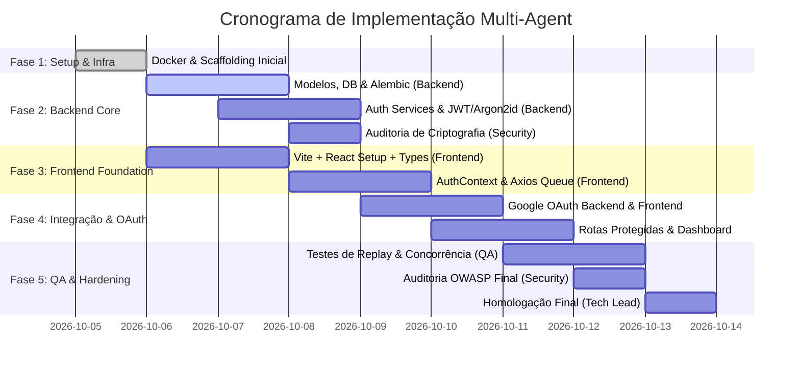

# Plano de Implementação e Delegação Multi-Agent

Este plano orienta a execução ordenada e colaborativa das equipes/agentes para a construção do **Laboratório de Autenticação**, utilizando os documentos em `docs/` como fonte única da verdade.

---

## 1. Visão Geral das Fases

---

## 2. Matriz de Delegação por Agente

### 🐍 Backend Agent
- **Tarefa B-1 (Infraestrutura de Banco & Modelos)**:
  - Configurar engine assíncrono com SQLAlchemy 2.0 e driver `asyncpg` (`app/core/database.py`).
  - Implementar os modelos `User`, `RefreshToken` e `AuditLog` com campos conforme `docs/architecture.md`.
  - Configurar Alembic assíncrono e gerar a primeira migração (`001_initial_schema.py`).
- **Tarefa B-2 (Serviços Criptográficos e Schemas Pydantic)**:
  - Implementar hashing Argon2id com parâmetros seguros (`pwdlib`/`passlib`).
  - Implementar criação e decodificação de JWTs com claims rigorosas (`exp`, `sub`, `jti`, `token_type`).
  - Implementar Schemas Pydantic v2 estritos conforme `docs/api-contract.md`.
- **Tarefa B-3 (Endpoints de Autenticação Local e Rotação)**:
  - Implementar rotas `/api/v1/auth/register`, `/login`, `/refresh`, `/logout` e `/me`.
  - Implementar token rotation, emissão de cookies HttpOnly e lógica de detecção de reuso com revogação da `family_id`.
- **Tarefa B-4 (Autenticação Federada Google)**:
  - Integrar SDK `google-auth` para validação criptográfica do Google ID Token.
  - Implementar endpoint `/api/v1/auth/google` (vincular/criar conta e emitir tokens).
- **Tarefa B-5 (Testes Automatizados do Backend)**:
  - Criar testes unitários e de integração com Pytest cobrindo happy path e edge cases de login, tokens e refresh.

### ⚛️ Frontend Agent
- **Tarefa F-1 (Scaffolding e Contratos de Tipos)**:
  - Inicializar SPA React 18+ com TypeScript e Vite.
  - Copiar os tipos de `docs/api-contract.md` para `src/types/auth.ts`.
  - Configurar sistema de design/tokens modernos com paleta escura sofisticada e responsividade.
- **Tarefa F-2 (Cliente HTTP com Gestão de Concorrência)**:
  - Configurar Axios com `withCredentials: true` e base URL dinâmica.
  - Implementar interceptor de resposta com fila de requisições pendentes e mutex para execução de *silent refresh* sem race conditions (conforme `docs/decisions.md` ADR-005).
- **Tarefa F-3 (Gerenciamento de Estado e Contexto)**:
  - Criar `AuthContext` e hook `useAuth`, mantendo o Access Token exclusivamente em memória.
  - Implementar método de inicialização silenciosa na montagem do app (`checkAuthSession`).
- **Tarefa F-4 (Páginas e Componentes)**:
  - Criar telas: Login (com formulário e Google Sign-In button), Cadastro e Dashboard Protegido.
  - No Dashboard: exibir dados do usuário, tempo restante do Access Token (countdown timer) e botões para disparar requisição protegida de teste, forçar refresh manual e efetuar logout.
- **Tarefa F-5 (Proteção de Rotas e Testes)**:
  - Implementar componente `ProtectedRoute` no React Router.
  - Criar testes unitários para o `AuthContext` e interceptor do Axios via Vitest.

### 🛡️ Security Agent
- **Tarefa S-1 (Auditoria de Políticas de Cookies e CORS)**:
  - Validar atributos dos cookies (`HttpOnly`, `Path=/api/v1/auth`, `SameSite=Lax`, `Secure`).
  - Auditar CORS no FastAPI para assegurar que apenas origens autorizadas sejam permitidas e nenhum wildcard com credentials ocorra.
- **Tarefa S-2 (Auditoria Criptográfica de Hashes e Tokens)**:
  - Inspecionar a parametrização do Argon2id (memória, tempo, paralelismo).
  - Validar que Refresh Tokens são armazenados no banco apenas como hash SHA-256 e nunca em texto claro.
  - Inspecionar a validação do Google ID Token (JWKS, issuer, audience e expiration).
- **Tarefa S-3 (Revisão da Implementação de Detecção de Reuso)**:
  - Auditar a lógica de revogação de tokens e verificar se a `family_id` é integralmente invalidada em caso de tentativa de replay.
- **Tarefa S-4 (Simulação de Ataques e Testes Negativos)**:
  - Testes de injeção, força bruta e bypass de tokens expirados/falsificados.

### 🧪 QA / Test Agent
- **Tarefa Q-1 (Matriz de Cenários de Teste)**:
  - Mapear todos os Requisitos Funcionais de `docs/requirements.md` em casos de teste de aceitação.
- **Tarefa Q-2 (Testes Automatizados de Integração API)**:
  - Suíte de testes verificando fluxos completos: Cadastro -> Login -> Me -> Refresh -> Logout.
  - Teste de expiração de token: aguardar/forçar expiração do Access Token e validar renovação transparente.
- **Tarefa Q-3 (Teste de Estresse de Concorrência do Refresh)**:
  - Disparar 10 requisições simultâneas contra rota protegida com Access Token expirado e verificar se exatamente 1 chamada de refresh é feita ao backend e todas as 10 requisições originais são atendidas com sucesso.
- **Tarefa Q-4 (Teste de Detecção de Reuso de Refresh Token)**:
  - Simular o cenário de replay: emitir par de tokens, realizar refresh legítimo e em seguida submeter o refresh token antigo revogado. Confirmar retorno 401 e constatar que o novo par também foi invalidado imediatamente.

---

## 3. Mecanismo de Revisão Cruzada Obrigatória (Cross-Review Gates)

Para garantir que nenhum agente atue isoladamente:
1. **Gate 1 (Contratos e Modelos)**:
   - Backend envia os Schemas Pydantic para validação do Frontend Agent.
   - Frontend confirma se os tipos TypeScript em `src/types/auth.ts` são compatíveis 1:1.
2. **Gate 2 (Fluxo de Tokens e Cookies)**:
   - Security Agent inspeciona o código de configuração de cookies do Backend e o cliente Axios do Frontend antes que qualquer tela seja integrada.
3. **Gate 3 (Detecção de Reuso e Concorrência)**:
   - QA Agent e Security Agent executam os testes concorrentes e o teste de replay attack em conjunto.
4. **Gate 4 (Homologação Final)**:
   - Tech Lead executa o ambiente completo via `docker-compose up`, valida todos os logs e assina a homologação da release.
